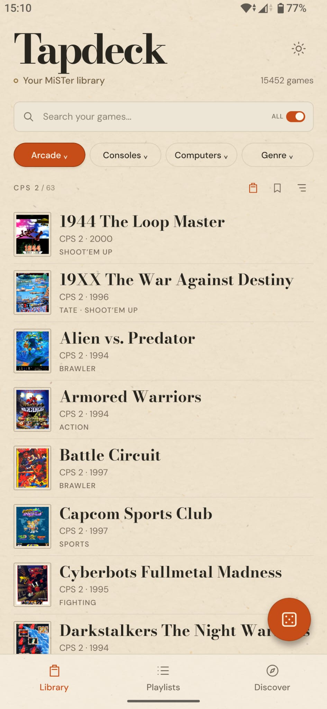
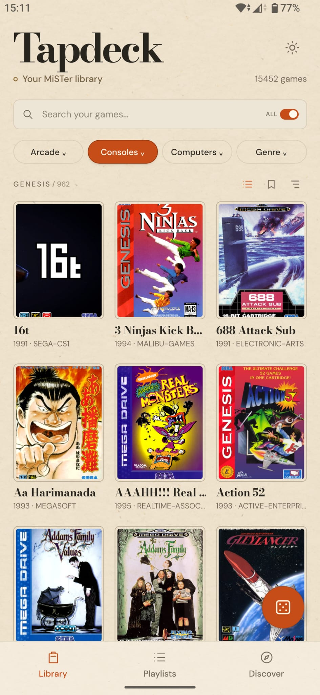
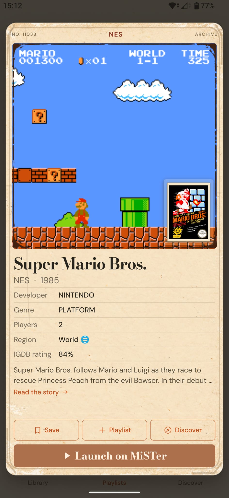
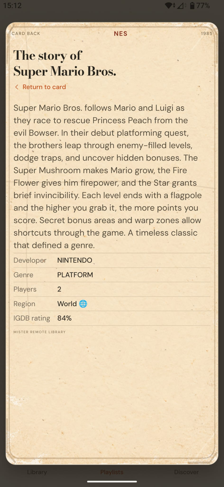
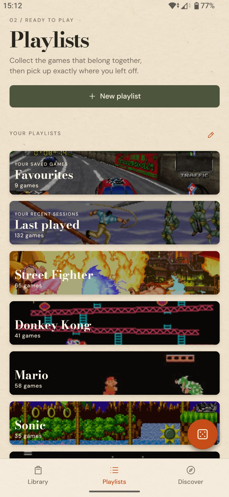
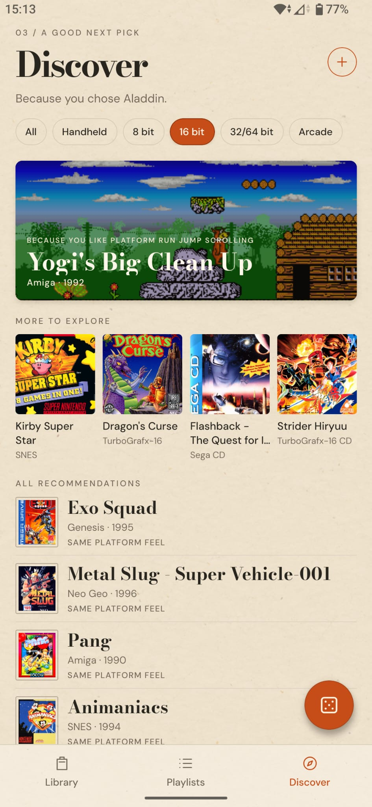
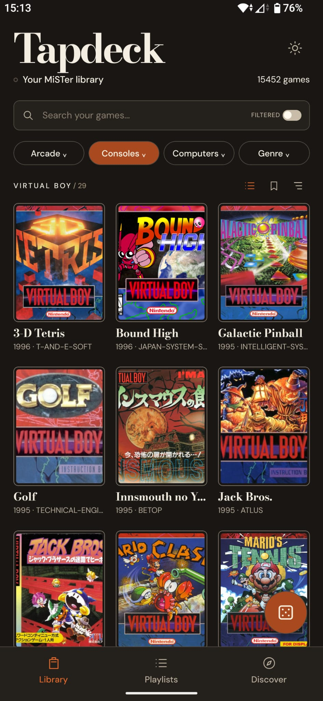
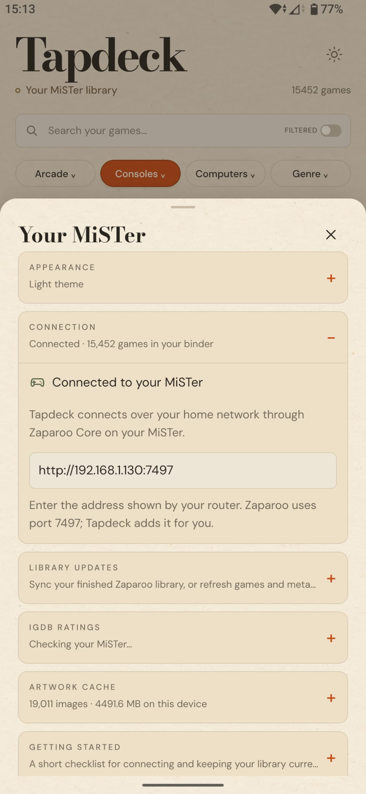

<p align="center">
  
</p>

<h1 align="center">Tapdeck</h1>

<p align="center">
  <strong>Your MiSTer library, in your pocket.</strong><br />
  A beautiful, fast way to browse, rediscover and launch the games you already own.
</p>

<p align="center">
  <a href="#building-an-android-apk">Build for Android</a>
  ·
  <a href="#getting-started">Getting started</a>
  ·
  <a href="#mister-setup">MiSTer setup</a>
  ·
  <a href="./CHANGELOG.md">Changes</a>
  ·
  <a href="./docs/storage-safety.md">Storage safety</a>
</p>

## See Tapdeck in use

<table>
  <tr>
    <td align="center"><a href="./docs/screenshots/1.jpeg"></a></td>
    <td align="center"><a href="./docs/screenshots/2.jpeg"></a></td>
    <td align="center"><a href="./docs/screenshots/3.jpeg"></a></td>
    <td align="center"><a href="./docs/screenshots/4.jpeg"></a></td>
  </tr>
  <tr>
    <td align="center"><a href="./docs/screenshots/5.jpeg"></a></td>
    <td align="center"><a href="./docs/screenshots/6.jpeg"></a></td>
    <td align="center"><a href="./docs/screenshots/7.jpeg"></a></td>
    <td align="center"><a href="./docs/screenshots/8.jpeg"></a></td>
  </tr>
</table>

## Your collection deserves better than a folder browser

Tapdeck turns a MiSTer library into a tactile game binder. Browse cover art, screenshots and metadata; filter across systems and genres; make playlists; find something you have not played in years; then launch it on your MiSTer from the sofa.

It is built for large, mixed MiSTer libraries: arcade boards, consoles, computers, CD-based systems and custom MGL launches all belong in one place.

## Trust, storage and source code

Tapdeck is currently distributed as source code. Each GitHub Release contains the exact tagged source archive so you can inspect it and build your own Android APK. If you prefer not to build a side-loaded app, please wait for a future store or independent Android repository release.

The complete source is public under the [Tapdeck Free Use and Distribution License](./LICENSE). You may use, modify and share Tapdeck for free, retaining the licence notice. Selling or distributing Tapdeck or modified versions for payment requires written permission. Earlier MIT releases retain their original permissions. Some game artwork and metadata originate from third-party sources and are not granted by this licence.

Tapdeck does not mount, unmount, disable, format or alter MiSTer storage. Its USB recovery only performs read-only path checks when a drive has been assigned a different `/media/usbN` slot after reboot. The exact behaviour and the optional helper changes are documented in [Storage safety](./docs/storage-safety.md).

## What it does

- **A library you can actually browse** — list and three-column card views, fast search, system and genre filters, sorting, favourites and Last Played.
- **Make your own shelves** — create playlists, add games in batches, and put together a queue for any mood or hardware setup.
- **Favourites and save states** — sort or always show favourites first; a floppy icon marks supported games with save states, and Launch offers dated save choices when the updated Tapdeck Helper is installed.
- **Artwork that gets out of the way** — on-device artwork caching, Libretro thumbnail support and graceful fallbacks when a title has no art.
- **Discover what to play next** — recommendations based on your library, platform groupings and cached ratings. Closely related labels such as Brawler and Beat ’em Up can recommend one another without being merged in the library.
- **Metadata where it helps** — game details from your MiSTer library, with optional IGDB ratings for titles that have no rating in their gamelist.
- **Launch from the phone** — Tapdeck sends launch requests through MiSTer Remote, including direct MGL launches for systems outside the usual mappings. When an arcade title has multiple installed MRA versions, choose the Default, Alternative or MeatCores version before launch.
- **Made for use in the room** — haptic feedback, full-screen game cards and Android back navigation.
- **Light or dark, by choice** — switch the reading surface in Settings → Appearance. Tapdeck remembers the choice on the device.

## Getting started

1. Clone the source or download a tagged source archive from [Releases](https://github.com/MiSTerTapdeck/Tapdeck/releases).
2. Build an Android APK using the instructions below, then open it on an Android phone or tablet and allow installation when Android asks.
3. Put the phone and MiSTer on the same home network.
4. Open Tapdeck, enter your MiSTer’s IP address, then connect and sync the library. To import `gamelist.xml` files, select the affected systems in Library updates and run **Full Refresh**.

Tapdeck remembers the connection and keeps a local copy of the library so the binder opens quickly.

## MiSTer setup

Tapdeck uses two separate MiSTer services for different jobs:

- **Zaparoo Core** indexes the library and supplies its paths and metadata.
- **MiSTer Remote** performs the actual game launch requests.

Install and run both before connecting Tapdeck. MiSTer Remote handles normal launches; Neo Geo Pocket and Pocket Color retain their dedicated Zaparoo launch path.

Some additions are optional:

- [Tapdeck Helper](./integrations/tapdeck-helper/README.md) — one MiSTer service for AmigaVision launching, missing IGDB ratings, optional local artwork, separate Neo Geo AES/MVS configurations and TATE metadata. Includes migration from the three separate helpers and a rollback script. MiSTer Remote carries out launches.

Install only `integrations/tapdeck-helper/package`: copy its contents to `/media/fat/Tapdeck-Helper` and run `sh /media/fat/Tapdeck-Helper/install.sh` on MiSTer. No separate AmigaVision, IGDB or TATE helper installation is needed. Older packages remain for historical reference and rollback; their install scripts are disabled.

## A note on artwork and metadata

Tapdeck can offer dated save-state choices on Launch for nine tested console systems, using the updated Tapdeck Helper. This reads existing save states rather than battery-backed in-game saves. See [save-state setup and testing limits](./integrations/tapdeck-helper/README.md#save-state-launch-choices).

Tapdeck reads the metadata already available in your MiSTer library. It can download matching artwork to the Android device, so cover art becomes faster after its first use. If a game has no metadata or artwork, it stays visible and usable.

IGDB support runs inside Tapdeck Helper on the MiSTer. Rating lookups are used when you configure IGDB, and its rating cache stays on the MiSTer. Existing credentials and cached ratings are retained when migrating from the separate helper.

With Tapdeck Helper installed, you can opt in to local artwork folders in **Settings → Artwork cache**. Tapdeck then fills missing artwork from `boxart` and `snaps` folders alongside your games. Existing phone-cached artwork stays first, followed by your local images, then Libretro. Jaguar and Jaguar CD check both system folders. Local artwork works without IGDB credentials; see the [helper setup](./integrations/tapdeck-helper/README.md#features-and-existing-data).

For `gamelist.xml`, Zaparoo must be configured to find the game folders (for example, `[scraper.gamelist_xml]` with `custom_path = '/media/usb0/games'`). **Sync library from Zaparoo** reads its current catalogue; **Full Refresh** rebuilds the index, imports XML metadata and reads the results into Tapdeck. Virtual core-launch entries are excluded from these selections because Zaparoo cannot index their IDs; real indexable systems remain selectable even with zero games.

After a completely fresh installation, enter the MiSTer address, configure optional IGDB credentials and enable local artwork if wanted. Migration preserves existing helper credentials and saved Neo Geo BIOS profiles. If local artwork is enabled but missing after setup, toggle it off and on to reload the index; the underlying refresh issue is still under investigation.

## Development

Requires Node.js 24 LTS.

```sh
npm ci
npm start
```

Run these before submitting a change or making a build:

```sh
npm run typecheck
npm test
```

The web preview is useful for layout checks. Test MiSTer connection, artwork refresh, launch and gestures on a physical Android device before publishing an APK.

## Building an Android APK

The current release is **1.0.6**. Update both the app and Tapdeck Helper for save-state choices and list indicators. The unified helper uses port 8184.

Tapdeck releases contain source code only. You can build an Android APK in either of these ways:

**Local Android build** — install Android Studio and the Android SDK, then run:

```sh
npx expo run:android --variant release
```

**EAS build** — fork the repository, remove `expo.extra.eas.projectId` from `app.json`, sign in with `npx eas-cli login`, run `npx eas-cli init`, then run:

```sh
npx eas-cli build --platform android --profile release
```

For private testing, use the `preview` profile instead.

On the maintainer's Windows machine, `BUILD TAPDECK.cmd` offers Development, Preview and Production local builds. It uses a dedicated short build path and local signing credentials; those private credentials are not included in this repository.

## Project layout

- `src/` — native app screens, components and library/launch logic.
- `integrations/` — Tapdeck Helper source/installer and the retained separate helpers for rollback.
- `tests/` — regression tests for library handling, artwork, playlists, discovery and launch routing.
- `scripts/` — maintenance tools for sample content and artwork indexes.


## Contributing

See [CONTRIBUTING.md](CONTRIBUTING.md) for local setup and pull-request guidance. For security issues, use [SECURITY.md](SECURITY.md).
